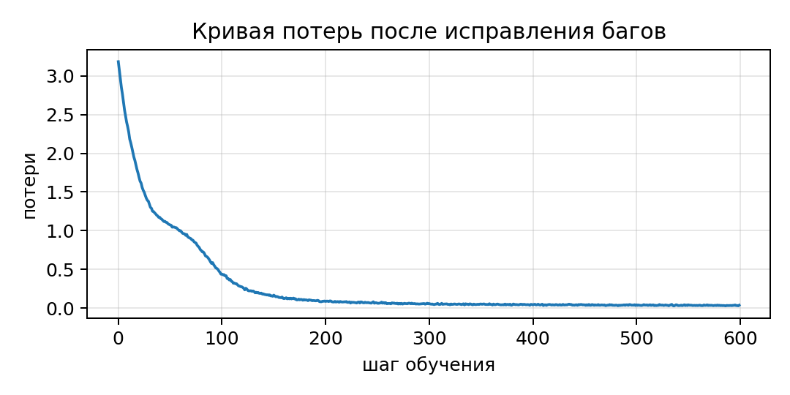

# Отчёт по ДЗ 1

## Ошибки в варианте 42

| Локализация в ячейке с моделью | Механизм и причина сбоя | Исправление |
|---|---|---|
| `sinusoidal_positional_encoding`, строка 39 | Отсчёт с единицы сдвигал фазу синуса и косинуса каждого канала на одну позицию. В кодировке первого токена ожидались пары (0, 1), но вычислялись значения для позиции 1. | `torch.arange(length)` задаёт позиции от 0 до `length - 1`. |
| `LayerNorm.forward`, строки 60–61 | Среднее и дисперсия по оси батча связывали представление токена с другими примерами на той же позиции. При батче из одного примера среднее совпадало с входом, поэтому нормированная часть обнулялась и выход зависел только от смещения. | `mean` и `var` с `dim=-1` считают статистики по признакам каждого токена. |
| `scaled_dot_product_attention`, строка 101 | Softmax по оси запросов нормировал столбцы. Сумма весов ключей для одного запроса могла отличаться от единицы. При причинной маске будущий запрос участвовал в знаменателе разрешённого столбца и мог изменить вес на прошлой позиции. | `torch.softmax(scores, dim=-1)` нормирует веса по разрешённым ключам каждого запроса. |

## Проверки

В исходном `dz1-bughunt.ipynb` прошло 7 из 17 открытых проверок. После исправлений оба ноутбука прошли 17 из 17. Среди них есть проверка причинной маски и проверка снижения потерь при обучении на одной последовательности.

## Обучение и генерация

В предоставленном ноутбуке корпус состоит из 200 повторов одной фразы, словарь содержит 19 символов. Модель с 400 640 параметрами обучалась 600 шагов. Ориентир с 62 символами, 107 тысячами параметров и 500 шагами относится к другой конфигурации.

| Шаг | 0 | 100 | 200 | 300 | 400 | 500 | 599 |
|---|---:|---:|---:|---:|---:|---:|---:|
| Потери на батче | 3,1844 | 0,4395 | 0,0858 | 0,0581 | 0,0405 | 0,0411 | 0,0369 |



Генерация после обучения, включая начальный символ:

```text
ания смотрит на все позиции сразу. алгоритм внимания смотрит на все позиции сразу. алгоритм внимания смотрит на все позиции сразу. алгоритм внимания смотрит на все позиции сразу. алгоритм внимания смот
```

Модель воспроизводит порядок слов, пробелы и точку в конце фразы. График показывает потери на обучающих батчах, а генерация показывает, насколько хорошо модель запомнила повторяющийся шаблон.

Вывод и график получены в Windows на CPU с Python 3.12.10 и PyTorch 2.15.0+cpu. Повторный прогон на CPU воспроизвёл значения потерь, график и текст. Seed обучения и генерации равен 0. Полная конфигурация и команды запуска приведены в [README.md](README.md).
